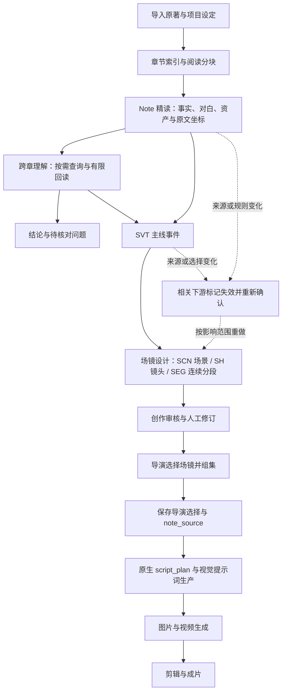
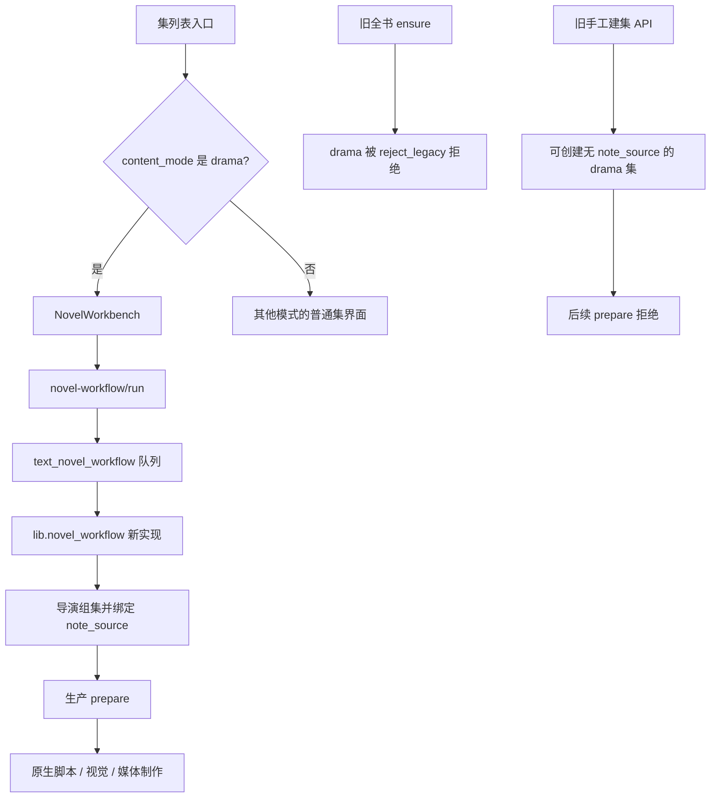
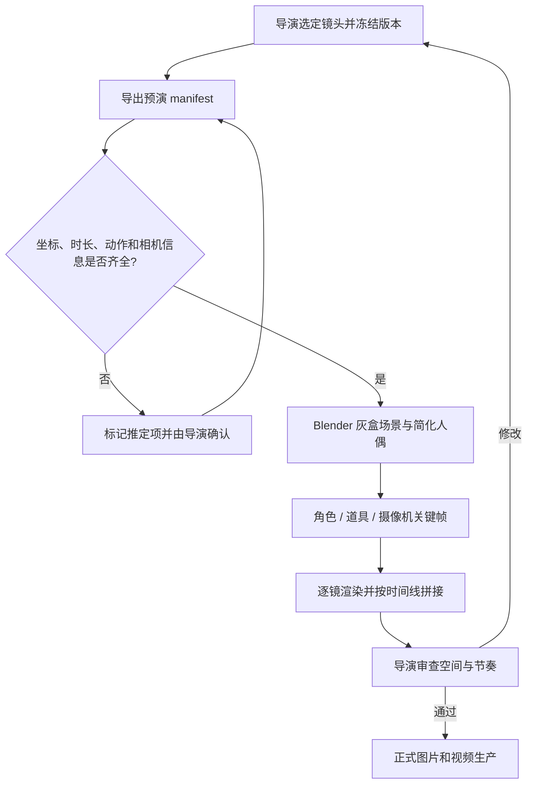

# 拆书工作台评估：同类方案对比、旧流程遗留、新流程图与白模预演

日期：2026-11-14（UTC）  
对象：`dawndst/ArcReel`，`feat/novel-production-foundation` 分支  
代码审计基线：[`c478ce6a34096f12563b75292d4388e40c77c2d3`](https://github.com/dawndst/ArcReel/tree/c478ce6a34096f12563b75292d4388e40c77c2d3)

> 本文将「代码已经实现」「仓库记录的历史结果」「建议新增」分开描述。对 ArcReel 的判断来自静态源码与调用链审计；没有运行服务或测试，没有核实 VPS 的部署版本，也没有在相同小说、模型和预算下对两个项目进行效果对跑。本文不修改程序行为。

## 执行摘要

1. **保留现有 Note → SVT → 场镜 → 导演组集架构。** 我们在长篇原著追溯、信息边界及生产工作台治理上有较深积累；`drama-skills` 更值得借鉴的是改编方法、视听连续性、实际素材验收和轻量执行方式，不宜整体替换。
2. **当前剧情项目主入口已走新流程，但旧代码尚未清理干净。** 不是两套完整系统并行可切换。旧全书阅读正常入口被封住，旧目录部分公共工具和新流程适配器仍被使用。
3. **发现一个可达的不完整旧入口。** 手工建集 API 仍可创建缺少 `note_source` 的剧情集，随后被新生产守卫拒绝。另有参考视频模式与导演组集之间的静态链路风险，需要测试确认。
4. **白模预演应是场镜/导演决策后的可选验证层。** 第四节单独评估 `blender-skills`，不把分析结论冒充已经完成的集成或视频产出。

## 一、与 drama-skills 的对比

### 1.1 对比范围与定位

对方是 [zenstory-ai/drama-skills](https://github.com/zenstory-ai/drama-skills)，阅读时的树对象为 `8cf7404981b7095b498e061832bb3c9ffd6a42be`。当前版本包含十二个技能，覆盖原著分析、开发、写作、视觉与分镜、提示词、生产、剪辑和审核。不能把它视为几段零散提示词。

我们的对象不是 ArcReel `main` 原版，也不是另一个早期 `novel-narration-workflow` 仓库，而是上述小说生产改版分支。两者定位不同：

| 维度 | 我们的拆书工作台 | drama-skills | 判断 |
|---|---|---|---|
| 核心组织 | 原文证据、Note、SVT、场镜、导演选择、原生媒体生产 | Agent 技能及创作文件驱动 | 保留我方工作台与来源结构 |
| 长篇小说 | 逐章提取、跨章按需检索与有限回读、信息状态追踪 | 从原著功能分析到改编开发的通用方法 | 我方来源与治理更深入；可引入对方改编取舍方法 |
| 分镜工艺 | SCN/SH/SEG 分层，原文承载及生产约束 | 镜头动作起终点、轴线、道具交接、参考图控制范围 | 对方提供了值得吸收的工艺细节 |
| 人工控制 | 编导选择、版本、变更失效及工作台入口 | 文件预览、确认后生产 | 两者有共同理念，交互形式不同 |
| 成片检查 | 小说模块的文字审查不等于实际视频审核 | 素材选择、剪辑、字幕/响度等事实检查 | 我方应补真实素材验收层 |
| 成片艺术质量 | 未在本次实测 | 未在本次实测 | 无依据宣布任何一方获胜 |

### 1.2 对方值得我们学习的内容

#### A. 显式记录改编取舍，而非仅记录来源

对方要求说明原著内容在改编中是保留、合并、换载体、压缩、省略、提前、冷开场还是新增；重排需处理因果和原位置的功能缺口。我们已有改编决策辅助：记录来源 Note 和证据、保留 / 压缩 / 组合 / 候选省略、理由、人物 / 伏笔 / 对白影响及必须保留内容，并在界面展示。它生成的是建议，不自动应用。建议**扩展现有结构，而非另建平行取舍表**：补充戏剧功能、人工采纳或驳回结果，以及与目标集 / 场 / 镜的映射，形成 `原文证据 → 改编建议 → 实际编导选择 → 成片承载` 的可追踪闭环。章节精编中的阅读删减是另一层，不等于导演已决定不拍。依据：[现有建议结构](https://github.com/dawndst/ArcReel/blob/c478ce6a34096f12563b75292d4388e40c77c2d3/lib/novel_workflow/models.py#L195-L209)、[审核实现](https://github.com/dawndst/ArcReel/blob/c478ce6a34096f12563b75292d4388e40c77c2d3/lib/novel_workflow/review.py)、[精编规则](https://github.com/dawndst/ArcReel/blob/c478ce6a34096f12563b75292d4388e40c77c2d3/lib/novel_workflow/rules/condense.md)。这些缺口是对已检查 schema、输出及界面的静态判断，尚未重跑验证。依据：[改编方法](https://github.com/zenstory-ai/drama-skills/blob/main/skills/short-drama-develop/references/adaptation-craft.md)、[小说分析](https://github.com/zenstory-ai/drama-skills/blob/main/skills/short-drama-novel-analyze/SKILL.md)。

#### B. 将连续性从抽象要求落实为镜头状态

分镜不仅应有景别和画面描述，还应检查角色站位、视线、左右手、持物者及交接落点；关键帧应表达动作起点，避免把最终结果错误画进首帧。建议在现有镜头数据中记录必要的起止状态，并对相邻镜进行差异校验，而非一律给所有镜头增加冗长文字。依据：[分镜技能](https://github.com/zenstory-ai/drama-skills/blob/main/skills/short-drama-storyboard/SKILL.md)。

#### C. 区分「计划的参考图」与「实际存在的参考图」

对方区分图片提示词条目、外部挂图计划与已核对的真实参考图，并声明参考图允许控制和不得控制的内容。我们应避免只有引用名却没有真实文件，或场景参考把不应出现的角色和机位一并带入。建议建立参考资产状态及控制范围字段，再接入实际媒体生产。

#### D. 让机械校验和创作判断各司其职

对方校验脚本核对来源引用、连续性锁和对白等可检查事实；这些通过不等于故事精彩、画面正确。我们可吸收跨文档交接校验，避免再增加一轮模糊的模型自评。依据：[校验器](https://github.com/zenstory-ai/drama-skills/blob/main/skills/short-drama/scripts/creator_markdown_check.py)。

#### E. 加强真实素材验收与失败恢复

对方先看片选择可用片段，再记录剪辑入出点；成片检查覆盖字幕、时长、响度和切点等。生产任务先预览确认，异步中断后优先找回已提交任务，减少重复提交成本。建议吸收这些机制，但不必复制全部交互步骤。依据：[剪辑技能](https://github.com/zenstory-ai/drama-skills/blob/main/skills/short-drama-edit/SKILL.md)、[生产技能](https://github.com/zenstory-ai/drama-skills/blob/main/skills/short-drama-produce/SKILL.md)。

### 1.3 我们已有的优势

- **长篇事实与来源结构扎实。** 原著章节、阅读块、事件和改编集不是同一对象。Note 记录资产、状态、关系、因果和对白，并关联原文位置；跨章按需查询和回读，不把检索范围冒充实际阅读范围。依据：[Note/SVT 流程](https://github.com/dawndst/ArcReel/blob/c478ce6a34096f12563b75292d4388e40c77c2d3/docs/novel-note-svt-workflow.md)、[阅读规则](https://github.com/dawndst/ArcReel/blob/c478ce6a34096f12563b75292d4388e40c77c2d3/lib/novel_workflow/rules/read.md)。
- **信息边界细致。** 区分事实、人物说法、推测和梦境；区分真相揭示位置和故事适用时间，避免后文知识倒灌前文造型与身份。未知说话人不能强行归给已知人物。依据：[生产审核工作流](https://github.com/dawndst/ArcReel/blob/c478ce6a34096f12563b75292d4388e40c77c2d3/docs/novel-workflow/production-review-workflow.md)。
- **忠实度要求落实到观众接收。** 事件仅写在标题、目的或引用中不算已呈现；必须由可见动作或可听对白承载。依据：[创作审核规则](https://github.com/dawndst/ArcReel/blob/c478ce6a34096f12563b75292d4388e40c77c2d3/lib/novel_workflow/rules/craft_review.md)。
- **产品化和人工编导控制更突出。** 规则版本、选择历史、上下游失效和原生媒体能力形成工作台，不是仅有文件模板。依据：[规则目录实现](https://github.com/dawndst/ArcReel/blob/c478ce6a34096f12563b75292d4388e40c77c2d3/lib/novel_workflow/rule_catalog.py)。

这些是结构和实现层面的优势，不代表运行无误，也不能据此推导最终成片艺术质量更高。

### 1.4 我们的不足与避免照搬的部分

1. 仓库费用复盘记录过两章一轮约 367 次调用、约 20.07 美元，不能当作合理目标；后续已有限次预算、缓存和问题整理显式触发等改进，但仍需测量优化后的实际结果。建议提供「快速样片 / 严谨改编」两档。依据：[复盘](https://github.com/dawndst/ArcReel/blob/c478ce6a34096f12563b75292d4388e40c77c2d3/docs/novel-workflow/production-review-workflow.md)、[调用预算](https://github.com/dawndst/ArcReel/blob/c478ce6a34096f12563b75292d4388e40c77c2d3/lib/novel_workflow/call_budget.py)。
2. 规则完整不等于表达优秀。应增加优劣镜头示例、视听设计和真实样片诊断，而不是持续堆长 prompt。
3. 对方也不是完全自动的一体化制片产品，文件操作和生产仍有约束；公开评测不足以证明其全面领先。参考：[设计](https://github.com/zenstory-ai/drama-skills/blob/main/DESIGN.md)、[评测边界](https://github.com/zenstory-ai/drama-skills/blob/main/evaluations/README.md)。
4. 不应把题材相关的节奏经验直接变成所有作品通用硬阈值。最终需同章节、同预算的盲评，而不是只比较规则数量。

## 二、旧流程遗留审计

### 2.1 结论：新主链路已经接通，旧实现未完全清除

剧情项目当前入口是新流程；旧的全书阅读和 AI 分集不是一套仍可由开关恢复的并行系统。旧目录仍保存实现和历史规则，部分文件又被用作新流程适配器，因此不能直接删除整个目录。

### 2.2 当前新流程的实际调用链

| 层级 | 代码证据 | 行为 |
|---|---|---|
| 前端 | [EpisodesView L16–23](https://github.com/dawndst/ArcReel/blob/c478ce6a34096f12563b75292d4388e40c77c2d3/frontend/src/components/canvas/episodes/EpisodesView.tsx#L16-L23) | `drama` 直接进入 `NovelWorkbench`，不依赖旧开关 |
| 操作 | [NovelWorkbench L222–234](https://github.com/dawndst/ArcReel/blob/c478ce6a34096f12563b75292d4388e40c77c2d3/frontend/src/components/canvas/novel-workflow/NovelWorkbench.tsx#L222-L234) | 调用 read / understand / conclusions / svt / scenes / review |
| API | [novel_workflow 路由](https://github.com/dawndst/ArcReel/blob/c478ce6a34096f12563b75292d4388e40c77c2d3/server/routers/novel_workflow.py#L121-L133) | 校验 drama，提交新任务 |
| 队列 | [任务提交](https://github.com/dawndst/ArcReel/blob/c478ce6a34096f12563b75292d4388e40c77c2d3/server/tool_runtime.py#L2680-L2694) | 新建 `text_novel_workflow` 任务 |
| 执行 | [任务分派](https://github.com/dawndst/ArcReel/blob/c478ce6a34096f12563b75292d4388e40c77c2d3/server/tool_runtime.py#L2775-L2860) | 调用新的精读、理解、SVT、场镜等实现 |

### 2.3 遗留清单及风险

| 项目 | 当前状态 | 风险及建议 |
|---|---|---|
| 旧全书 reader、归纳、审核代码 | 仍存在；正常入口不可达 | 技术债，迁出共享能力后再删 |
| 旧 `applicable()` 判断 | 条件互斥，当前恒 False | 改成明确兼容策略，避免误导维护者 |
| 旧手工切集 UI / 模型 / 规则文件 | 仍有残留，当前 drama 主界面不使用旧切集组件 | 按引用和测试逐项清理，不凭文件名批量删除 |
| 手工建集 API | 仍可对 drama 创建无 `note_source` 的集 | 可产生下游无法生成的不完整数据，优先修复 |
| reference_video 与导演组集 | 条件存在静态冲突 | 需补集成测试确认预期支持范围 |
| 旧目录的新适配器和通用工具 | 新流程仍在使用 | 删除整个目录会破坏现有调用 |
| 文档中的旧开关说明 | 部分历史说法与当前代码不一致 | 明确当前 / 历史 / 规划版本 |

#### 旧 reader 为什么不可达

`ensure()` 首先对 drama 执行 `reject_legacy`。即使不是 drama，后面的 `applicable()` 也要求两个互斥条件：`store.enabled()` 要求模式为 drama，而 `applicable()` 同时要求模式不为 drama。因此不能说「非 drama 仍在走旧全书流程」。依据：[reject_legacy](https://github.com/dawndst/ArcReel/blob/c478ce6a34096f12563b75292d4388e40c77c2d3/lib/novel_workflow/routing.py#L8-L16)、[ensure](https://github.com/dawndst/ArcReel/blob/c478ce6a34096f12563b75292d4388e40c77c2d3/lib/novel_understanding/service.py#L252-L257)、[applicable](https://github.com/dawndst/ArcReel/blob/c478ce6a34096f12563b75292d4388e40c77c2d3/lib/novel_understanding/service.py#L97-L105)、[enabled](https://github.com/dawndst/ArcReel/blob/c478ce6a34096f12563b75292d4388e40c77c2d3/lib/novel_understanding/store.py#L30-L34)。

#### 可达的手工建集残留

`POST /projects/{name}/episodes` 仍注册；底层只拒绝广告项目，没有拒绝 drama。由此可创建缺少 `note_source` 的剧情集，后续脚本/视觉生成又被新 `prepare()` 拒绝。这是半截兼容入口，**不是安全审计意义上的恶意后门，也不是旧完整流程仍能使用**。建议拒绝该模式并引导导演组集，或提供明确的迁移/绑定功能。依据：[路由](https://github.com/dawndst/ArcReel/blob/c478ce6a34096f12563b75292d4388e40c77c2d3/server/routers/episode_management.py#L85-L103)、[create_episode](https://github.com/dawndst/ArcReel/blob/c478ce6a34096f12563b75292d4388e40c77c2d3/lib/episode/episode_management.py#L65-L87)。

#### 参考视频模式的链路风险

`director.assemble` 拒绝 `generation_mode == reference_video`；而参考脚本规划仍经 `prepare()` 要求 drama 集有 `note_source`。普通新建项目可能无法经标准入口取得所需来源绑定。应测试后决定支持、迁移或明确禁用，不应把静态风险说成已运行复现。依据：[导演限制](https://github.com/dawndst/ArcReel/blob/c478ce6a34096f12563b75292d4388e40c77c2d3/lib/novel_workflow/director.py#L70-L80)、[参考脚本准备](https://github.com/dawndst/ArcReel/blob/c478ce6a34096f12563b75292d4388e40c77c2d3/server/text_generation.py#L1714-L1748)。

#### 不能整体删除旧目录的原因

旧 `service.prepare()` 已承担新流程适配：有 `note_source` 的 drama 项目调用新的 `novel_workflow.production.prepare`。停止信号、hash、时间等工具也有复用。应先迁移这些依赖，再删除死逻辑。原生脚本规划、视觉提示词和媒体生成是新流程复用的下游能力，不应误删。依据：[prepare](https://github.com/dawndst/ArcReel/blob/c478ce6a34096f12563b75292d4388e40c77c2d3/lib/novel_understanding/service.py#L496-L523)、[停止信号复用](https://github.com/dawndst/ArcReel/blob/c478ce6a34096f12563b75292d4388e40c77c2d3/server/tool_runtime.py#L2742-L2755)。

特别注意：新 `NoteProductionGuard.check` 检查的是来源版本新鲜度，不是对模型输出忠实度的语义保证。依据：[生产守卫](https://github.com/dawndst/ArcReel/blob/c478ce6a34096f12563b75292d4388e40c77c2d3/lib/novel_workflow/production.py#L59-L85)。

## 三、新流程图

### 3.1 业务主链路

下图描述当前阶段组织，不表示每次操作都会自动串行执行全部节点。理解、结论整理和审核等操作可按界面及任务条件触发；人工选择不应被 AI 自动确认替代。

说明：

- 一章一 Note 不等于一章一集；阅读分块更不能直接当改编集。
- SCN 是连续时空，SH 是无切点的连续镜头；SEG 仅用于同镜头连续生成，不应将反打等切镜藏在 SEG 内。
- 导演组集写入 `note_source` 后接原生制作，不另建一套重复的资产与提示词系统。[导演组集写入](https://github.com/dawndst/ArcReel/blob/c478ce6a34096f12563b75292d4388e40c77c2d3/lib/novel_workflow/director.py#L159-L182)
- 「剪辑与成片」表示下游生产目标，不表示小说模块已经自动完成多模态成片审核。

### 3.2 当前路由和遗留入口

### 3.3 建议的清理顺序

1. 为 drama 手工建集入口和 reference_video 模式补回归测试，先确定产品预期。
2. 封堵或正式兼容不完整建集入口；明确参考视频模式支持边界。
3. 迁出共享工具和生产适配器，再删旧 reader 与已无引用的组件、规则、测试。
4. 更新唯一流程说明和规则目录；区分历史内容，避免维护者误以为可切回旧流程。
5. 验证其他模式的普通建集、脚本和媒体生成未被误伤。

## 四、blender-skills 白模预演可行性

### 4.1 结论与能力边界

**可以作为白模（白膜）预演的辅助工具，但不是开箱即用的「小说自动转预演视频」系统。** [arjun988/blender-skills](https://github.com/arjun988/blender-skills/tree/904f095d8f36a6e72adaebb08d07f884a074743d) 在本次分析基线 `904f095d8f36a6e72adaebb08d07f884a074743d` 下，主要是指导 Agent 操作 Blender 的技能，依赖 Blender MCP / `bpy` 等执行能力。它能提供场景搭建、摄影机、动画和渲染方法，但 ArcReel 到 Blender 的数据适配、任务治理和验收仍需我们实现。

最适合验证的是空间站位、构图、轴线、道具交接、摄像机运动及切点节奏，不适合用来证明最终角色表演、美术、口型或生成视频质量。白模可提前暴露文本分镜的空间问题，但不会自动保证下游 AI 视频严格复现。

能力依据：

- [场景组装](https://github.com/arjun988/blender-skills/blob/904f095d8f36a6e72adaebb08d07f884a074743d/.claude/skills/scene-assembly/SKILL.md)
- [摄影机与摄影](https://github.com/arjun988/blender-skills/blob/904f095d8f36a6e72adaebb08d07f884a074743d/.claude/skills/camera-cinematography/SKILL.md)
- [动画](https://github.com/arjun988/blender-skills/blob/904f095d8f36a6e72adaebb08d07f884a074743d/.claude/skills/animation/SKILL.md)
- [渲染](https://github.com/arjun988/blender-skills/blob/904f095d8f36a6e72adaebb08d07f884a074743d/.claude/skills/rendering/SKILL.md)

### 4.2 推荐接入位置：导演组集后的可选验证层

以下是**拟议方案，尚未实现或运行验证**：

建议 `manifest` 至少包含：

| 类别 | 必要信息 |
|---|---|
| 可追溯性 | 项目、集、SCN/SH/SEG ID，来源版本、导演选择版本、预演规格版本 |
| 空间 | 坐标系、单位、场景边界、固定锚点、角色与道具位置/朝向 |
| 状态 | 镜头起止姿态、道具持有人与附着点、交接时刻 |
| 摄影机 | 位置、朝向或观察目标、焦距/视场、运动路径、构图约束 |
| 时间 | 帧率、每镜入出帧、关键动作时间码、声音占位和切点 |
| 不确定性 | 原文事实与编导设计分开，缺失值及推定值显式标记 |

不应让 Agent 在生成 Blender 场景时静默补出关键空间事实。原文没有坐标时，可以由编导设计，但应标为设计决策并保存。SCN 是场景，SH 是镜头，SEG 只是同镜头的连续生成段，不能将三个概念混成任意切镜单位。

### 4.3 分阶段验证

- **P0：最小场景。** 一个室内场景、两个人物、一个道具、三个镜头，先检查每镜首/中/尾帧。通过站位、视线、道具交接和轴线检查后再渲染视频。
- **P1：短预演。** 5–10 镜、约 30–60 秒，使用简化人偶和关键帧，不先追求复杂表情或动作捕捉。核验镜长、运镜、切点、遮挡及对白占位。
- **P2：工程接入。** 增加队列、失败恢复、缓存、源版本变更失效、逐镜重渲染和导演批准记录，再考虑批量生产。

验收应记录：镜头数与时长是否匹配；人物/道具是否连续；关键动作在画面中是否可读；相机是否穿模或丢失主体；镜头修改后是否只重做受影响产物；实际耗时、算力和人工修订次数。当前没有实测数据，不能承诺渲染速度、单集成本或固定节省比例。

### 4.4 环境、许可与安全边界

1. 仓库示例 `.mcp.json` 使用 Windows 的 `cmd /c`，不能直接复制到 Linux VPS。需按实际 OS、Blender 版本及 MCP 服务配置改写和验证。[MCP 设置说明](https://github.com/arjun988/blender-skills/blob/904f095d8f36a6e72adaebb08d07f884a074743d/docs/BLENDER_MCP_SETUP.md)
2. 本次未安装 Blender/MCP，未测试当前服务器的版本兼容性、无头渲染、显卡或资源限制。正式集成前必须做环境验证，不能由「有技能文件」推导「VPS 可运行」。
3. MCP 能执行 Python，应采用隔离、低权限执行环境，不公开暴露控制端口，不挂载生产密钥和无关私人文件。渲染任务应有资源、路径和超时边界。
4. 复制其代码或技能文件需保留相应 MIT 许可与版权声明，并逐项检查另行引入的模型、动画及素材许可。

推荐决策：先做 P0/P1 证明空间预演能减少人工返工，再决定 P2 工程投入；不要为了预演另建一套与 ArcReel 冲突的小说理解或分镜系统。

## 五、建议实施优先级与验证标准

| 优先级 | 工作 | 验收重点 |
|---|---|---|
| P0 | 修复不完整建集入口，测试参考视频模式 | 不产生下游必然拒绝的剧情集；支持边界明确 |
| P1 | 旧逻辑清理与文档统一 | 新流程及其他模式回归通过，公共依赖不被误删 |
| P1 | 改编决策落地闭环与镜头状态校验 | 来源可追溯，事件实际可见/可听，交接和站位不矛盾 |
| P2 | 快速/严谨两档及项目预算 | 记录耗时、费用、人工修订量，而非只计算调用次数 |
| P2 | 白模预演小样 | 先验证少量场景的构图、调度和剪辑节奏，不追求最终美术 |
| P3 | 真实素材审片与失败恢复 | 生成产物确实可用，任务可恢复，避免重复花费 |

公平比较两套创作方法时，应使用同一章节、同一交付规格、可比模型与预算，盲评信息准确性、戏剧表现、镜头可执行性、人工修订量、总成本。原文坐标检查通过不能当作语义准确率；格式复现不能当作创作质量稳定。
