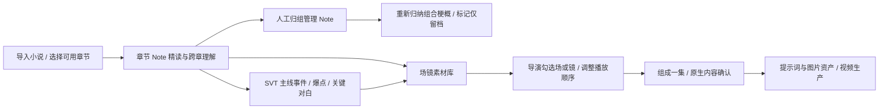

# 资料归组与导演组集分离

本设计取代「Note 组合对应一集」的旧桥接。旧的 groups/{id}/episode API 已移除。

## 资料组合

资料组合是对原始章节 Note 的人工归组。章节树折叠展示组内成员；原文、章节身份、事实和累计知识均保留。一个 Note 同时属于一个资料组，需要调整时先解散再归组。组合可以设为「改编候选」或「仅留档」。仅留档不会删掉小说理解资料，但不会作为场镜生成或组集来源。

组合内章节精读完成后，用户可以单独触发「重新归纳组合梗概」。归纳按有证据的事实分批压缩、逐层汇总，不要求一次发送全部原文，不创建集。依据变更会显示梗概过期。组合不存在或被解散时，进行中的结果不得重新创建该组合。

## 场镜素材库

选择已精读、已完成必要跨章理解的章节后，显式运行场镜生成。每个请求只读有界原文片段、该片段的资产与事件、已揭示的理解依据。SVT 只传递当前事件的主线归属，不能把后文总结注入早期镜头。原文范围外的内容不参与。场镜输出引用原文的精确位置；对白必须能在所给原文中找到。

场、镜使用独立且稳定的素材 ID，不提前编号为某一集。镜头内分段按视频模型支持的时长且每段不超过 15 秒；长镜头通过 SEG 延续动作与对白。没有可改编内容时允许零场镜，但必须给出原因。模型生成不触发集登记。现支持剧情演绎的分镜路线，参考生视频的 video-unit 路线不混用此结构。

项目 novel_workflow/scene_library.json 保存当前候选。重新生成受影响片段会保存历史版本，已选来源变更会阻止未经核对的后续生产。原文变化后需先刷新章节索引，再按有效性判断更新素材。

## 导演组集

导演可勾选整场或其中的独立镜头。已选列表支持移除和上下排序，显示累计秒数；长镜头的 SEG 整体随镜头选取，避免只选到半段。不同素材场在播放顺序中相邻成组，分配集内场号、镜头号和 SEG 号。

填写成片集标题后提交不会调用 LLM。系统把所选镜头的动作、对白、时长和原文锚原样转换为原生 DramaNormalizedScript，进入内容确认，而不是再次对整章进行 AI 规划。集原文只包含所选镜头的证据摘录；director_selection 保存素材 ID、内容指纹和制作镜头映射，note_source 保存事实来源版本。生成提示词前继续验证依据。

组集使用 request_id 去重。登记集后若原生内容发布失败，明确记录 pending，并在场镜素材库显示继续完成入口；相同请求重试恢复同一集，不能静默创建副本。导演可以把相同素材另选为其他集，但必须是新的显式编排请求。

## 可替换规则

group.md 只负责组合梗概；scenes.md 只负责场镜规划。各项目可在 novel_workflow/rules 下放同名规则覆盖，不与章节精读或 SVT 共用一个提示词。规则变更参与缓存和产物有效性检查。

## 验证

定向验证覆盖资料归组不创建集、仅留档保护、范围外依据拒绝、虚构引文与不支持时长拒绝、生成缓存复用、导演排序和 SEG 保留、只选定镜头进入集、来源变化拦截、原生内容确认，以及发布失败的幂等恢复。线上检查使用只读页面 fixture，不启动小说精读或收费模型生成。
