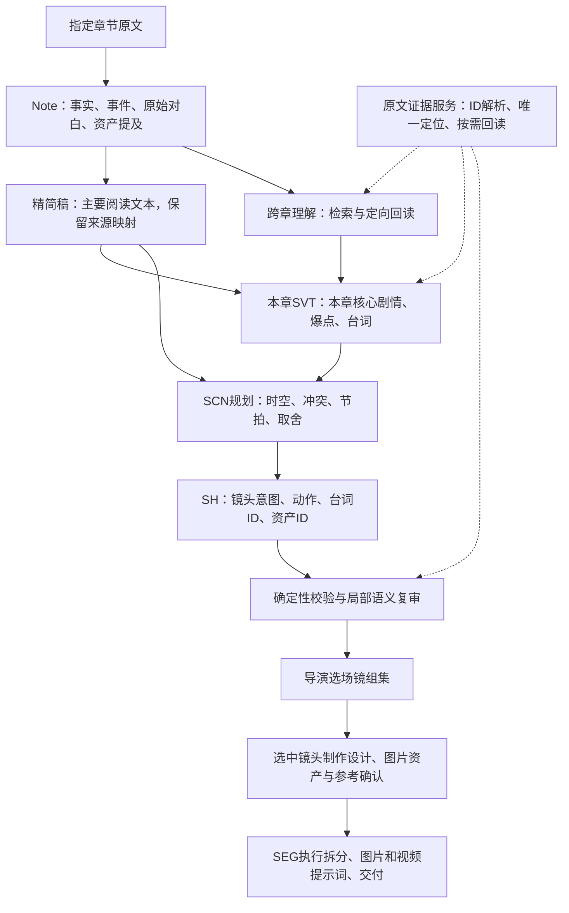

# 小说改编工作台全流程审查

日期：2026-11-15。代码基线：`dd910278d61e0487dc893f64d6bfccdf09cf3665`。

结论：已有精简稿确实接入了 SVT 和场镜，问题不是“完全没用精简稿”，而是**阅读材料、叙事单元、引用契约、修复单位和任务状态没有统一**。逐个放宽引文匹配不能解决这个设计问题。应保留小说理解与防剧透成果，整体重构场镜的阶段契约及公共任务执行方式。

本次沿工作台正常接口追踪 Note、精简稿、跨章回查、结论、SVT、场镜、复审、镜头设计、导演组集及制作交付；核对了真实 API 请求日志与浏览器状态。没有重新生成内容、调用模型、重跑全量测试或修改生产数据。当前第一章场镜任务失败在 1/4，已完成部分保留。

## 1. 已核实的真实故障

两次任务分别在 2026-11-15 11:18:30–11:23:35 UTC、11:32:01–11:39:55 UTC 运行。第一回失败在第一批；恢复后第一批完成，第二批再次失败。API 账本 983–992 共 10 次模型返回均为成功，工作流却两次失败：这是**返回结果未满足业务校验**，不是这些调用发生了供应商 503。

| 调用 | 阶段 | 输入 token | 输出 token | 实际请求字符数 |
|---|---|---:|---:|---:|
| 983–985 | 第一批场镜初稿及整份重试 | 23,993–24,314 | 8,689–12,658 | 47,877–48,312 |
| 986–988 | 第一批语义复审及结构重试 | 23,099–23,185 | 620–1,340 | 45,072–45,365 |
| 989 | 第一批镜头设计 | 37,903 | 4,172 | 76,382 |
| 990–992 | 第二批初稿及整份重试 | 36,888–37,219 | 12,713–15,821 | 73,548–73,985 |

这些数字来自 `api_calls`，字符数不等于 token 数。不能把模型 API 返回成功、JSON 可解析、原文引用成立、剧情语义正确、人工采纳视为同一个状态。

第一章原文 21,716 字符，精简稿 14,300 字符。第二章原文 28,134 字符，精简稿 21,346 字符。场镜仍按第一章 4 个、第二章 6 个原文位置区间装配输入：

- 第一章第一批：原文区间 5,981 字符，发送 3,660 字符精简稿和 81 条离散原文摘录。红光报错中缺少的“鲜红的光在变形、舞动”不在该次实际初稿请求中；重试请求也没有补入这段文字。
- 第二批：原文区间 5,766 字符，发送 3,939 字符精简稿和 97 条原文摘录。宣誓事件材料存在，但引文从多次出现的“台辅”起头，拼接后的摘录无法唯一定位。
- 第二批实际输入 JSON 中，`events` 占 36,282 字符、`key_dialogues` 8,093 字符、`moments` 9,091 字符。同一批对白、依据和事件在多处重复携带，精简稿减少了阅读正文，却没有充分减少整体请求。

代码：[`condensation.material`](../../../lib/novel_workflow/condensation.py)、[`scene_library.generate`](../../../lib/novel_workflow/scene_library.py)、[`service.ask`](../../../lib/novel_workflow/service.py)。

## 2. 每一步实际使用什么

| 阶段 | 当前实际主输入 | 原文用途 | 审查判断 |
|---|---|---|---|
| 泛读 Note | 当前原文片段、有限前后文、已读记忆 | 首次建立事实、资产提及、事件、对白和证据 | 首次阅读使用原文合理。无需改成从精简稿首次抽取事实。 |
| Note 语义复审 | 当前草稿和同一片段原文 | 核对事实性质、说话人、因果和遗漏 | 已有局部修订协议，应保留；引文定位失败等部分路径仍会回到整份重试。 |
| 整章概况 | 有界归纳已提取记录 | 引用既有证据 | 正确方向，不应重新读全书。 |
| 章节精简稿 | 原文单元和受保护证据 | 原文映射、关键对白保护、待定内容回填 | 已保存位置映射。精简稿是工作阅读版，不是新的事实原本。 |
| 跨章精读回查 | Note 的语义记录、疑点、检索规划 | 检索并回读相关原文片段 | 原文回读在这里有意义。保持范围和揭示边界，无需把所有原文反复塞入提示词。 |
| 问题回收与结论 | 概况、事件、关联、证据池、人工决定 | 回收疑点、保留事实与推测区别 | 已有分阶段阻挡。仍须明确疑点真正影响哪些事件、场镜和制作环节。 |
| SVT／爆点 | 精简段落、事件索引、原始对白、概况与约束 | 不足或疑义时按事件请求原文 | `svt_material` 已实现 `source_requests`，应成为场镜的参考实现。 |
| 本章 SVT 标题简介 | 本章已审查概况和事件标题索引 | 通过已审查 Note 追溯 | 不需要重复读全文。每章核心剧情与共享主线必须继续分开。 |
| 场镜初稿 | 当前原文区间对应的精简稿、离散引文、事件、对白、爆点和资产 | 校验却使用完整原文区间 | 输入与校验不对称，缺少显式回读请求；仍让模型复写已存在的原文内容。 |
| 场镜语义复审 | 初稿、完整本批原文、关键对白 | 独立语义核对 | 复审有意义，但问题定位、修订有效性与严重度没有充分结构化。 |
| 镜头制作设计 | 完整本批原文、全部镜头、事件／爆点、资产绑定 | 支持镜头设计与关联 | 重复发送材料，且为未被导演采用的全部镜头支付细化成本。 |
| 导演组集 | 所选镜头及排序、已确定内容和资产引用 | 保留来源映射 | 机械转交与幂等发布值得保留；组集前仍过早绑定较重的制作资料门槛。 |
| 观众理解检查 | 所选镜头真实可见画面与可听台词 | 不发送原著，避免用小说知识替成片补脑 | 这是正确实现，不能为了“更准”重新塞入整本原文。 |
| 视觉编写与制作交付 | 组集后正式脚本、设计、资产和参考图 | 来源版本检查、按需核查 | 继续采用内容与视觉层分工；图片人工确认和原生配音偏好保留。 |

## 3. 优先级最高的设计缺陷

### P0 输入和校验契约不对称

`condensation.material` 返回精简文字及不带独立来源 ID 的摘录列表；`scene_library.ground` 却要求每镜的 `quote` 能在完整原文中连续定位。模型没有明确的 `source_requests` 回读分支。缺少连接文字时，让模型再“抄准一点”不能补齐未提供的材料。

**统一改法：**场镜输出选择已有 `event_id`、`source_span_id`、`dialogue_id`，程序从证据库回填原文。需要新依据时发出显式回读请求。原文连续性和唯一性仍要校验，但校验程序组装的来源，避免模型反复重写证据文本。

### P0 通用重试把所有错误变成整份重写

`service.ask` 将结构错误和业务 `ValueError` 一并捕获，最多三次重发完整材料。反馈只追加错误文本，并没有把上一版草稿和受影响目标作为版本化补丁输入。一个引用位置出错，可能重新输出几十个正确镜头及全部台词。

**统一改法：**区分供应商／截断、schema、引用、关联、语义问题。只有无法解析的响应需要重建结构；引用错误修来源引用，缺失对白修对应分配，语义问题修指定场镜。每次修复以版本和目标 ID 为约束，保留其余内容。

### P0 章级完成状态错误

`NoteProductionActions.noteProductionStatus` 的 `scenesForAll` 仅检查“每个 Note 是否至少存在一批场镜”，没有检查预期批次是否齐全。真实浏览器复现：第一章失败在 1/4，仍显示“已有关联场镜……再由导演勾选组集”，按钮为“查看场镜（6场／14镜）”。

**统一改法：**后端发布章级任务清单及各单元状态，前端区分“部分完成”“待复核”“生成完整”“制作待补”。允许查看和选用有效局部素材，但不得把部分成果标成全章完成。默认动作是“继续未完成部分”，不是隐藏在更新菜单里的整章重做。

### P1 精简稿没有成为语义分批的中心

`chapters.chunks(limit=6000)` 决定精简稿零件边界，场镜又复用这些边界。字符边界是传输约束，不一定是同一场戏、完整对话回合或关键状态转变的边界。初稿也没有接收前一批已生成镜头的明确终态。

**统一改法：**按本章 SVT、事件因果、时空与对话链形成 SCN 规划，再按 SCN 和节拍生成 SH。长场可分请求，但保留同一 SCN、全场节拍清单和上次已完成的终态，不能因为请求切块就重新开场或重演动作。

### P1 已有 schema 没走原生结构化通道

`service.ask` 把 schema 序列化进提示词，却构造了未设置 `response_schema` 的 `TextGenerationRequest`。底层 OpenAI 与 Gemini 适配器已有原生结构化输出及降级分支，本工作流没有使用。

**统一改法：**公共执行器显式传递本阶段 schema，按实际模型能力选择原生通道与受控降级，并分别核算修复调用。原生 schema 只能帮助保证结构，不能证明原文和剧情正确，不能替代证据校验或语义复审。

### P1 对白先重复生成，再反向匹配 ID

输入已有对白 ID，但初稿输出仍是自由文字和人名。后续 `shot_production.dialogue_links` 用文字包含关系和镜头大段依据重新寻找原对白；同一句话或多个说话人容易出现多解。初稿的重复对白检查以单个 SH 为单位，不能证明全场没有重复搬运。

**统一改法：**原文台词以 `dialogue_id` 及需要时的合法子区间分配到 SH／SEG，程序回填原句和出处。同字句的不同原文位置使用不同 ID。允许同一事件由多个 SH 表现，不能机械要求“一个事件只许一个镜头”；重复台词、反应镜头和有意重播要区分。

### P1 场镜初稿的缓存依赖不完整

初稿键包含 Note、场镜规则、理解上下文、时长档位和主线事件标签，未包含实际使用的精简稿版本、本章核心剧情版本、完整爆点内容或语义审核规则。已有批次命中后直接进入 `complete_batch`，可能绕过新版本语义复审。镜头设计有自己的依赖指纹，不能代替初稿与复审依赖。

**统一改法：**按阶段记录实际输入依赖：来源、精简段落、事件／对白、本章 SVT、爆点、资产与规则。改了谁，只将受影响的单元置为待更新；视觉或执行档位变化不应默认重做剧情和对白。

### P1 审核建议失效被当成小说疑点

`scene_review.validate_review` 会把位置无效、`before` 不一致、审核引文失真等无效建议转成 `unresolved` 中文字符串。`require_reviewed` 又按整批疑点阻挡；交付预览把某批问题挂到该批第一个所选镜头。这样“审核者输出格式不对”可能被交给用户当成“剧情事实未查明”处理，无关镜头也受影响。

**统一改法：**问题具有类型、严重度、目标场镜／事件、证据、阻挡阶段和可执行处理。无效审核建议进入审核修复／弃用流程；真正影响身份、因果或对白的冲突才进入剧情核对。拍法偏好只作建议。明确场级问题可影响多个镜头，但不能用整批字符串代替作用范围。

### P1 初稿、制作设计与模型执行条件耦合过早

初稿已要求 SEG 秒数命中当前视频模型档位；随后必须为全部镜头生成制作设计，组集也检查制作信息。模型切换和未采用镜头的细化成本因此提前进入创作流程。第一批设计请求达 76,382 字符，里面再次包含原文、事件、爆点、镜头和资产数据。

**统一改法：**初稿先提供足以选镜的动作、对白与基本镜头意图；导演组集后补齐选中镜头的详细制作资料。参考时长留给编导调整。SEG 执行拆分满足不超过15秒及供应商能力，不能把供应商档位当成故事节拍，不新增语速预算硬门槛。

### P1 资产事实、引用和揭示时序仍有粗粒度处理

场镜生成会跳过整个 `claim_type=statement` 资产提及，并在生成前检查整章资产问题。应区分“某人／物实际出现”与“角色声称它是谁／归谁”。另外，结论约束有按本原文块末尾取已揭示证据的逻辑，尚不足以形成每个 SH 的明确知情边界；这是需在新契约中覆盖的提前揭示风险，不代表本次已确认出现了相关成片错误。

**统一改法：**保留资产实体及年龄、形态、伤势等变体；独立维护在场、发声、身份确定性、外观状态和揭示位置。只在相应阶段阻挡真正缺失的制作资料，普通路人或未知说话人可作为待确认角色继续规划。

### P1 一次性人工脚本不能算成产品恢复能力

之前恢复失败响应及校对部分 SVT 措辞，使用了一次性运行脚本；这些证明材料可修复，却不能证明普通工作人员在界面内能完成相同操作。候选草稿缓存已加入正常流程，但无效候选目前仍会回到整份重写。

**统一改法：**生成、局部修复、人工采用、继续任务和依赖更新均走产品 API。验收不得依赖手改数据库、缓存或临时脚本。

## 4. 其他项目的具体做法

以下是源码／规则对照，不是外部项目的真实成片验收，不能据此宣称它们已解决所有长篇一致性问题。固定提交便于复核。

| 项目与源码 | 可借鉴 | 不直接照搬 |
|---|---|---|
| [shuohao novel-script](https://github.com/eternityspring/shuohao-skills/blob/8af10e0ea1a550e4575666884f4deef780bf38ff/skills/novel-script/SKILL.md)、[storyboard 校验代码](https://github.com/eternityspring/shuohao-skills/blob/8af10e0ea1a550e4575666884f4deef780bf38ff/skills/novel-storyboard/scripts/novel-storyboard.mjs#L725) | 剧情节拍和镜头分开；镜头认领上游节拍，程序核对覆盖、顺序和引用；程序搬运既有事实。 | 它先分集，且 SEG 是一次生成、内部包含 cuts；与我们的先场镜后组集、SH 连续镜头／SEG 时间切分不同。其语速预算、固定切镜时长及硬覆盖规则也不能直接搬入。 |
| [zenstory 原著分析](https://github.com/zenstory-ai/drama-skills/blob/047ae8625021f038ee7581d6222064f0c169ce59/skills/short-drama-novel-analyze/SKILL.md)、[分镜契约](https://github.com/zenstory-ai/drama-skills/blob/047ae8625021f038ee7581d6222064f0c169ce59/skills/short-drama-storyboard/references/stage-contract.md)、[审查规则](https://github.com/zenstory-ai/drama-skills/blob/047ae8625021f038ee7581d6222064f0c169ce59/skills/short-drama-review/SKILL.md) | 章节索引共用，基于逐章提取形成剧情单元；分镜覆盖上游场次；审查问题有位置、证据、影响、局部修法、责任边界和分级。硬不变量、拍法建议与审美偏好分开。 | 它主要是文件／会话技能，不等同于已具备 API 任务状态、并发和数据库恢复的产品。我们仍需自己的执行器。 |
| [huobao 分镜工具](https://github.com/chatfire-AI/huobao-drama/blob/b48e6b2312166e25b1ff141832d2e82e5d63c142/backend/src/agents/tools/storyboard-tools.ts)、[分镜规则](https://github.com/chatfire-AI/huobao-drama/blob/b48e6b2312166e25b1ff141832d2e82e5d63c142/backend/workspace/prompts/storyboard_breaker.md) | 从剧本与资产上下文拆镜，绑定资产 ID；提供局部更新工具，按分镜号幂等 upsert，支持分批落库。 | 没有我们同等级的小说证据／防剧透要求。SEG／cuts 和语速预算不同；函数内有先清旧内容再逐条写新内容的路径，不照搬到保留有效成果的恢复流程。提示词“每批最多8段”也不等于工具 schema 已强制该上限。 |
| [Toonflow 导演](https://github.com/HBAI-Ltd/Toonflow-app/blob/6086cdffceb704a632eca143dd16cd461a78cdac/packages/teams/storyboardTeam/members/director.md)、[审阅者](https://github.com/HBAI-Ltd/Toonflow-app/blob/6086cdffceb704a632eca143dd16cd461a78cdac/packages/teams/storyboardTeam/members/reviewer.md) | 编写／审阅／统筹职责分开；只处理委派范围，返回具体局部问题，不把未查看素材写成已验收。 | 本次核对的是团队协议，不足以证明其长篇理解与小说证据层优于现有工作台；不因有多个 agent 就认为质量有保证。 |
| [ArcReel 上游内容确认 ADR](https://github.com/ArcReel/ArcReel/blob/c5c45560cc3ab28e81a45d33ed370537bbdda81b/docs/adr/0080-review-confirm-materializes-script-prompt-authoring-fills-pending.md)、[内容规划提示词](https://github.com/ArcReel/ArcReel/blob/c5c45560cc3ab28e81a45d33ed370537bbdda81b/lib/prompts/prompt_templates/templates/text/drama_script_plan.md) | 内容与视觉分层；确认后以正式脚本为内容真相，视觉编写只补待编写项，减少多份内容相互覆盖。 | 上游按集规划，不替代我们的 Note／SVT／人工选场镜组集。其原文锚允许空、逐字要求和时长策略不同，不能靠放松到同样标准来宣称解决了引用问题。 |

另核对原 study-main 的拆书规则：其长线人物、主线事件、名场面、伏笔、原文台词分工仍有保留价值；提示词经验不能替代 API 输出契约、版本和恢复机制。

## 5. 统一改造方案

保持现有业务顺序，不恢复旧自动分集入口，也不要求读完整本书。用户仍按可用章节工作，导演仍以场与镜组成最终集。

### 五项完整能力

1. **共享材料与证据服务。** 复用 Note 现有证据和对白 ID，为精简段落保留稳定 ID 与原文映射。每个阶段声明需要的材料，统一去重装配；原文只作为证据底座与定向回读材料。不能一刀切禁止原文，也不能为了校验方便再让下游默认读完整章。
2. **章内 SCN／SH 规划契约。** 用本章精简稿、本章 SVT 和完整事件索引确定场面；动作与对白形成有来源的节拍。场面覆盖不能仅靠“同属一 Note”判断。模型选择引用 ID、设计拍法，程序复制原话与原文坐标。SCN 规划是场镜内部步骤，不增加一个要求工作人员反复点按钮的独立流程。
3. **阶段执行与局部恢复。** 记录各场的规划、初稿、校验、复审、修复状态；已完成单元与当前失败单元独立。通用执行器负责模型能力、结构化输出、调用记账和错误分流；局部修订只动指定目标，复审只查返修及其关联边界。
4. **统一审核与人工处理。** 结构错误由程序指出并精确处理；事实／因果疑点由模型结合真实来源复核；风格、删改与镜头节奏交编导。问题卡提供直接定位、前后差异、采纳／修改／误报入口，处理后重算受影响项，不清空无关成果。
5. **清晰的组集交接。** 创作阶段的 SH 是可选素材；组集后形成正式内容快照，继续维护来源关联。详细设计、当前变体、参考图人工确认及模型执行 SEG 在选定内容上完成；下游不重新创作剧情，不将来源更新静默覆盖用户已编辑脚本。

### 核心数据关系

| 对象 | 主要字段与关系 |
|---|---|
| 来源引用 | `source_span_id`、来源版本、Note、文件／区间、揭示位置；程序解析原文 |
| 本章核心剧情 | `note_id`、本章标题／简介／推进、关键事件、共享主线关联 |
| SCN 规划 | `scene_id`、时空、戏剧目标、起止状态、顺序、事件／节拍引用及取舍 |
| 节拍 | `beat_id`、动作或对白、原始事件、原始对白、性质、揭示位置；可支持多个镜头 |
| SH | 稳定 `shot_id`、来源节拍、镜头意图、可见动作、声音／台词分配、资产与变体引用 |
| SEG | SH 内的连续执行区间、实际分配的台词、起止状态、参考图与供应商执行参数 |
| 问题与补丁 | 类型、严重度、目标 ID、版本、证据、影响阶段、修复操作、人工决定 |
| 任务单元 | 阶段、目标 ID、输入依赖、状态、已用调用、缓存与局部修复记录 |

继续使用现有 SQLite 与任务队列；规则和代码职责分开，每阶段 SKILL 可替换。数据库类型不是本次引用、重试和完成状态错误的原因。

## 6. 实施顺序与验收

按完整能力交付：先统一来源／输入和任务状态，再替换场镜规划、引用与修复契约，然后收敛审核及组集交接。旧的逐镜自由抄写引文、按原文块强行划场、校验失败整份重写路径一起退役，不再围绕每个新报错追加匹配特例。

验收必须包括：

- 第一、二章从现有 Note／精简稿出发，经正常 API 和界面完成场镜，不手改缓存或数据库，不重新泛读全书。
- 缺失连接原文、重复“台辅”、多人物短答、同字句不同出现位置、梦境／推测、跨请求的同场对话、人物变体与普通路人等场景的回放。
- 一处引文错误不能重生成全部正确镜头；无依据的语义仍不得自动通过。
- 某章 1/4 完成时，前后端均显示部分完成，保留成果，提供明确的继续入口。
- 关键事件、爆点与对白显示明确去向：实际承载、合理压缩、人工取舍或待补，不能只统计“有 ID”。
- 只检查所选内容的观众理解；未选剧情与后文知识不能用于替视频补因果。
- 验收记录实际模型调用、输入／输出 token、修复范围、耗时及人工修改，不用固定镜数或“引用都存在”冒充语义正确。
- 不增加语速预算拦截，不强制分集先于场镜，不把参考时长当成实际成片时长；SH 连续镜头、SEG 时间拆分的业务定义保持一致。

以上为改造前的审查与验收要求；下方实施记录和实际验收结果说明本轮完成状态。仅有局部引用补正和候选缓存不能视作完成重构。

## 实施记录：SVT 后续管线重构

保留已有 Note、精简稿、跨章理解及每章 SVT。场镜生产入口改为 `scene_pipeline.generate`，旧的按原文字符分块生成逻辑不再承担生产。

- `scene_material.Catalogue` 为事件、原句、来源和资产提及建立索引。SCN 规划读取整章精简稿与本章 SVT；SH 使用本场事件、相关精简段落、原始对白表和约束，按需回读来源。模型不再重抄原文引用或对白。
- `scene_contracts` 校验事件、爆点、资产和对白 ID，程序回填连续原文位置与原句。相同文字的不同发言保留独立来源 ID；台词不得在多个承载场面静默重复。
- `scene_pipeline` 保存每章的 SCN 清单和每场状态。长场内按完整事件划传输窗口（最多4个事件，累计超过60条台词时提前换窗；单个事件不截断），不因此新增 SCN。一个连续 SH 超过15秒才拆 SEG，时长属于编导参考，供应商执行档位在正式制作时处理。
- `stage_runner` 使用原生结构化输出，落盘候选、回读结果和局部修订历史。每次执行一个阶段最多3轮局部修订；回读最多2轮、40个来源，界面有说明；任务级调用上限仍沿用阅读设置。应用层次数不等于供应商适配器内部的网络重试次数。
- 局部修订须匹配候选版本，限制到错误路径；补镜时保留已正确镜头。审核者可撤回无依据的提议，不能把无效提议伪装成原著疑点。
- `scene_inspection` 独立复审当前场的事实、因果、发声归属、连续性与覆盖。问题带镜头范围及严重度，文字修订继续由人工采纳。映射原文段与镜头依据有重叠时，不能只因段落结束较晚就当成剧透；完全位于后续的来源不能用来提前改写。
- 场镜批次依赖精简稿、当前本章 SVT、事件／台词和阶段规则；审核规则更新复用 SCN/SH，只重审。Notes/SVT 的规则及依据版本不因该改造失效。
- 后端 `scene_status` 成为整章是否生成完成的依据。旧的 1/4 草稿不能证明整章完成；界面展示真实场数、阶段、局部失败和继续入口。替代章完成前保留旧草稿，已有新规划时不与新结果混作当前生产素材。
- 基础景别、机位、动作、起止画面、声音设计与事件／爆点关联随 SH 一次生成，不再为所有候选额外执行一轮镜头设计调用。导演只选择所需素材组集，原生制作和资产图确认沿用现有流程。组集不要求固定语速预算；正式导出仍需制作资料和资产确认。

规则分别为 `scene_outline`、`scene_shots`、`scene_inspection`、`scene_patch`，可在项目规则目录各自替换，并在工作台规则页查看。流程说明页同步说明新的主输入、来源回填和逐场复审。

### 后续清理与制作衔接

- 删除旧的场镜生成、整批自由文本复审和额外镜头设计的模型调用入口，以及 `scenes`、`scene_review`、`shot_production` 三份旧规则。当前生产只采用四个独立的新阶段规则。完成替代章后删除旧批次和失效候选，不再混入当前列表。
- 对白重复按来源 ID 判断。同一个来源 ID 被重复分配时只保留第一次并记录规范化；原文不同位置的同字台词保留各自 ID。来源导航优先用 ID 定位实际发言位置，避免“早上好”“台辅”等短句跳错位置。
- 人工明确资产本体和形态后，通过正式 API 自动回填对应待定引用、已有来源 ID 的明确发声角色，不改剧情或对白，不调用模型。视觉年龄、伤势、梦境和真实变身不能相互代用；未确认形态仍限制正式交付。
- 原生制作只读取导演所选镜头实际使用的资产及变体，不因未选章节的资产缺失而拦截，也不发送未选剧情或后续大纲。原生结构化输出透传，不再额外包裹整份三次生成重试。
- 连续 SH 不超过 15 秒时，程序将内部演出段合成一个执行段，保留对白、动作、首尾画面和资产；长 SH 才保留 SEG。参考预览、交付包和原生脚本采用相同投影，原始审核目标不变。
- 场镜界面先展示剧情和对白，再展示审核、镜头设计及制作补充。工具栏按阅读、理解、SVT、场镜顺序组织，逐场进度移至当前章。普通建议、局部生成错误及正式制作前要求分别说明。
- 放行矩阵见 [复审与人工确认规则](../review-and-approval-gates.md)，工作流程页同步展示：每项明确操作者、是否调用模型、影响阶段和解除入口。无需清空所有建议才能建立参考集。

### 实际验收结果（2026-11-15）

通过工作台任务 API 完成现有第一、二章的 SCN/SH，没有重生成 Notes、精简稿、跨章理解或 SVT，也没有手改数据库或模型候选来通过验收。

| 范围 | 完成场 | 镜头 | 事件关联 | 爆点关联 | 来源对白去向 |
|---|---:|---:|---:|---:|---|
| 第一章 | 8/8 | 48 | 25/25 | 10/10 | 249 条承载，4 条建议省略 |
| 第二章 | 12/12 | 80 | 43/43 | 16/16 | 224 条承载，2 条建议省略 |

合计 479 个原始对白 ID 都有明确去向，没有未记录的遗漏。省略仍是建议，不代替编导取舍。来源区间、规范原句和关联校验通过，只能证明证据契约成立；不是所有镜头已获人工批准的声明。

- 正常 API 再次继续两章：20/20 完成，新增模型调用 **0**，清理旧批次后旧版本批次数为 0。
- 正常 API 将第二章一条明确的“阳子”表演状态关联到唯一现有人物本体，自动回填 58 镜；其他视觉形态仍保留待核对。随后对照摘要指纹，128/128 镜的标题、原文依据、动作、对白、首尾画面和参考时长未变；上游 Note/SVT 指纹未变。
- 选用第一章开头两场、9 镜，正式 API 建立“开篇·噩梦与顺从”参考分集；相同请求重试返回同一分集，左侧列表可见，没有重复建集。选镜校验限定到涉及的批次后，最终部署幂等重试实测约 2.82 秒。
- 对该分集完成真实交付预览、handoff、草稿 ZIP 导出和原生制作 dry-run。交付包含清单、来源和镜头资料、编导确认状态、取舍及衔接记录；未确认的制作问题保持可见。没有调用视频模型，也未伪造图片或编导批准。真实正式导出返回 409，说明未确认的制作内容不能被草稿导出绕过。
- 实际原文导航返回对应场的来源和 16 条对白位置。真实 Chromium 页面核验 Notes、场镜分层、参考分集入口及 12 项放行规则；无页面异常、无模型请求。
- 针对性后端套件 89 项通过；选镜范围调整后，来源与原生发布衔接相关 24 项再次通过。前端 7 文件共 36 项通过，完整 TypeScript 检查及生产构建通过。没有全量重跑。

开发与验收迭代的模型账本合计 105 次成功调用，记录费用约 8.45 美元；包含候选修复和调试，不代表日常两章的固定调用量或费用。最后一轮补齐剩余两场用了 2 次调用，后续恢复、关联和组集验收为 0 次。
