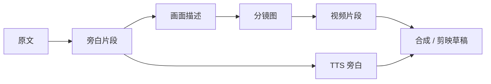

# 创作流程与模式 {#workflows}

ArcReel 支持多种内容来源和视频生成方式。本页帮助你在项目开始前选择正确路径，并定义每个阶段的审核标准。

## 1. 两个需要分别选择的维度 {#two-dimensions}

创建项目时，需要区分：

1. **创作类型**：决定脚本如何组织；
2. **生成模式**：决定使用分镜图还是资产图等参考图组织视频生产。分镜图生视频内可选多宫格分镜出图。

它们可以组合。例如：

- 剧情演绎 + 分镜图生视频；
- 剧情演绎 + 参考生视频；
- 旁白/解说 + 分镜图生视频；
- 广告短片 + 参考生视频。

## 2. 内容来源 {#content-sources}

### 2.1 小说原文 {#source-novel}

适合：

- 小说改编；
- 网文推文视频；
- 需要 AI 辅助分集和结构化剧本的项目。

ArcReel 会处理：

- 角色和别名；
- 关键场景；
- 关键道具；
- 剧情阶段；
- 分集边界；
- 分镜化描述。

建议：

- 第一次不要上传整部长篇小说；
- 先用一个剧情闭环的章节验证风格和供应商；
- 角色资产确认后再扩大制作范围。

### 2.2 成品剧本 {#source-screenplay}

适合：

- 已经拥有对白、旁白和场景说明；
- 希望尽量保留作者原稿；
- 只需要资产设计、分镜和媒体生成。

核心原则：

- 台词与画外音应尽量逐字保留；
- 角色以作者提供的人物表和剧本内容为依据；
- 群演和空镜不应自动膨胀为长期角色资产；
- 重点是规范化和分镜生产，而不是重新创作。

### 2.3 商品素材 {#source-product-material}

适合：

- 带货短片；
- 商品演示；
- 广告脚本；
- 品牌短视频。

准备内容：

- 商品正面、侧面、细节和使用场景图片；
- 核心卖点；
- 目标人群；
- 禁止出现的表述；
- 品牌视觉要求；
- 目标时长和发布平台。

广告/短片项目应优先建立稳定的商品资产图，再生成场景化分镜。

## 3. 创作类型 {#content-modes}

### 3.1 旁白/解说 {#narration-mode}

#### 特点 {#narration-traits}

- 旁白是主要信息载体；
- 画面为叙事和氛围服务；
- 按朗读节奏和语义停顿拆分；
- 更适合竖屏、节奏较快的短视频。

#### 推荐流程 {#narration-flow}

#### 审核重点 {#narration-review}

- 单段旁白是否过长；
- 每个画面是否承载一个清晰信息点；
- 画面是否只是机械复述旁白；
- 专有名词和人物名的 TTS 发音；
- 旁白与画面时长是否匹配。

#### 适用情况 {#narration-fit}

- 小说推文；
- 历史、故事和知识类内容；
- 旁白主导的商品介绍；
- 对角色口型要求不高的项目。

### 3.2 剧情演绎 {#drama-mode}

#### 特点 {#drama-traits}

- 场景、角色、对白和动作是主要结构；
- 更强调角色一致性和分镜衔接；
- 适合 AI 漫剧、剧情短片和成品剧本动画化。

#### 推荐流程 {#drama-flow}

#### 审核重点 {#drama-review}

- 每集是否有完整目标和情绪变化；
- 角色出场和服装是否连续；
- 分镜空间关系是否稳定；
- 台词、动作和分镜时长是否匹配；
- 相邻分镜视线和运动方向是否连续。

#### 适用情况 {#drama-fit}

- 小说改编；
- 连续剧式 AI 漫剧；
- 角色驱动的剧情短片；
- 已有对白剧本的动画化。

### 3.3 广告/短片 {#ad-mode}

#### 特点 {#ad-traits}

- 目标时长明确；
- 围绕卖点、使用场景和行动号召组织分镜；
- 商品真实性和参考一致性优先；
- 可生成口播文案、字幕和剪映草稿，配音在导出后完成。

#### 首次录入与故事设定 {#ad-first-input}

广告/短片项目没有单独的初始化页。新建项目后，在项目概览填写：

- 「创作灵感」：想要的视频、目标人群、风格调性和重点卖点，以及目标总时长；
- 「商品」：点「添加商品」，在右侧面板填写名称和描述，创建后再上传商品图。没有商品时，也可以只凭创作灵感生成脚本。

广告/短片项目没有原文。梗概、类型、主题和世界观在视频页的「故事设定」tab 中编辑，AI 生成脚本时会参考这些内容；保存修改后，已生成的脚本会标为过期。

#### 推荐流程 {#ad-flow}

#### 审核重点 {#ad-review}

- 商品外形、Logo、颜色和结构是否真实；
- 卖点是否有事实依据；
- 分镜是否过度依赖生成模型补全商品细节；
- 首屏是否快速说明商品价值；
- 结尾是否有明确行动号召；
- 口播文案和字幕是否符合平台规范。

## 4. 生成模式 {#video-production-routes}

### 4.1 分镜图生视频 {#storyboard-image-route}

以单张分镜图作为视频输入。

#### 优点 {#storyboard-image-pros}

- 工作流最直观；
- 供应商覆盖通常最广；
- 易于针对单个分镜重做；
- 分镜审核与视频生成职责清晰。

#### 局限 {#storyboard-image-cons}

- 主要约束起始画面；
- 模型可能在运动过程中改变人物和细节；
- 分镜结尾不一定适合衔接下一分镜。

#### 推荐场景 {#storyboard-image-fit}

- 大多数首次项目；
- 分镜质量较高；
- 每个分镜相对独立；
- 需要快速切换供应商。

### 4.2 分镜图生视频的多宫格分镜出图 {#grid-storyboard-route}

多宫格分镜不是独立生成模式，而是分镜图生视频内的一种出图方式。把同一段落的多个分镜统一生成在一张或多张多宫格分镜中，经审阅后切分为每个分镜的分镜图，再分别生成视频。视频模型接收的仍是切分后的单张分镜图。

出图分两步：

1. **生成**：只产出多宫格分镜本身，不改动各分镜已有的分镜图。可在集页的「多宫格分镜图」视图中审阅，不满意就重新生成，或上传自己的联合图替换。
2. **切分落格**：确认满意后，在「多宫格分镜图」视图中点「切分落格」，或在对话中同意 Agent 切分。切分会覆写该多宫格分镜覆盖、且仍在剧本中的全部分镜图（已从剧本删除的分镜跳过），旧分镜图保留在版本历史中，可以回滚。

多宫格分镜按分镜数自动选用 2×2 / 3×3 的方形切分，单格比例与项目视频比例一致；分镜更多时按格数切成多张。更密的 4×4 / 5×5 只在图像模型的分辨率档配置为 4K 时可选——格数越多单格分辨率越低，低分辨率档下密集切分会拖垮下游视频画质。

分组由章节切分点决定：在分镜详情里打开「设为章节切分点」，从这个分镜开始另起一组。时间线上的新增、删除、调整顺序和章节切分点，在宫格项目里同样可用。

分组或组内顺序变化后，旧的多宫格分镜与新分组对不上，这一组显示为未生成，需要重新生成。已经从多宫格分镜切出的分镜图不受影响，照常可用。

组内个别分镜缺分镜图时，可以在分镜详情里单独生成，不必重新生成整组。

#### 优点 {#grid-storyboard-pros}

- 同一张多宫格分镜中的角色、场景和画风更容易保持一致；
- 可以一次审核一组连续分镜的构图和节奏；
- 适合先统一视觉方向，再逐镜生成视频。

#### 局限 {#grid-storyboard-cons}

- 多宫格分镜布局和切分规则增加复杂度；
- 每个格子的清晰度可能下降；
- 不适用于参考生视频和广告/短片项目。

#### 推荐场景 {#grid-storyboard-fit}

- 连续分镜包含相同角色、场景或道具；
- 多分镜一致性比单张分镜的自由度更重要；
- 希望成组审核构图、服装和整体画风；
- 长篇项目需要降低批次之间的视觉漂移。

### 4.3 参考生视频 {#reference-video-route}

不使用普通分镜作为唯一输入，而是直接提供角色、场景、道具或商品的资产图等参考图。

#### 优点 {#reference-video-pros}

- 可以更直接利用长期资产；
- 适合支持多参考图的视频模型；
- 可减少普通分镜生成步骤；
- 对角色或商品身份锚定更有帮助。

#### 局限 {#reference-video-cons}

- 不是所有供应商都支持；
- 参考图数量、类型和权重限制不同；
- 需要更好的提示词和资产筛选；
- 缺少明确分镜时，构图可控性可能下降。

#### 推荐场景 {#reference-video-fit}

- 模型拥有成熟的参考生视频能力；
- 角色和商品资产质量高；
- 重点是身份一致性；
- 希望减少分镜中间步骤。

## 5. 模式选择表 {#mode-selection-table}

| 需求 | 推荐创作类型 | 推荐生成模式 |
|---|---|---|
| 小说推文、旁白主导 | 旁白/解说 | 分镜图生视频 |
| 连续剧情和角色对白 | 剧情演绎 | 分镜图生视频（开启多宫格分镜）或参考生视频 |
| 已有完整剧本 | 剧情演绎 | 分镜图生视频 |
| 商品结构必须稳定 | 广告/短片 | 参考生视频优先 |
| 多分镜一致性要求较高 | 旁白/解说或剧情演绎 | 分镜图生视频（开启多宫格分镜） |
| 首次验证 ArcReel | 任意 | 分镜图生视频 |
| 供应商支持有限 | 任意 | 分镜图生视频 |
| 已建立高质量角色资产库 | 剧情演绎 | 参考生视频 |

## 6. 标准生产阶段 {#production-stages}

无论选择何种模式，都建议保留以下阶段。

### 阶段 1：项目目标 {#stage-project-goal}

明确：

- 发布平台；
- 比例；
- 目标时长；
- 受众；
- 画面风格；
- 预算上限；
- 是否需要旁白；
- 是否需要剪映继续编辑。

### 阶段 2：内容结构 {#stage-content-structure}

确认：

- 剧情或卖点顺序；
- 分集边界；
- 每个分镜的目的；
- 每集新出现的角色、场景和道具，以及 AI 给出的处理方式；
- 不应被改写的内容。

AI 规划每一集的脚本时，会对照已登记资产的名字、别名和描述，识别本集出场的角色、场景和道具。未登记的资产列在内容确认页的「本集新增资产」区，每一项附有 AI 给出的处理方式和依据：登记为新资产、归到已有资产、登记为衍生或不登记。确认前可以修改任意一项；确认后，这些资产随正式脚本一并登记。资产卡片上的别名用于帮助 AI 认出同一资产的其他称呼。

确认前，内容确认页上每个分镜的字段都可以修改，包括时长、角色 / 场景 / 道具引用、章节切分点、原文、台词和说话人。参考生视频的分镜没有引用列表和章节切分点，资产引用写在正文的 `@[名称]` 中。

- 时长从当前视频模型的档位中选择。不在档位内的时长标为红色并说明原因，改选后才能确认。
- 引用可以选择已登记资产，以及本集新增资产中处理方式不是「不登记」的项。
- 说话人可以从已登记角色和本集新增角色中选择，也可以写其他名字，例如不绑定声音的群演。

确认时，如果引用里还有既未登记、也不是本集登记的新增资产的名字，确认会被拒绝，并列出对应的分镜和名字。分镜的增删和顺序调整在确认后到时间线上进行。

### 阶段 3：资产图 {#stage-reference-assets}

确认：

- 主要角色；
- 常驻服装；
- 场景；
- 关键道具；
- 商品；
- 风格参考。

#### 角色衍生的资产图 {#derivative-sheets}

角色的换装、变身等另一套持续外观登记为衍生，在角色详情的「衍生」区块里查看与编辑。衍生资产图有两种来源：

- **生成**：以本体资产图为底图，按衍生的外观变化描述编辑生成。本体还没有资产图时不能生成。本体资产图重新生成后，生成的衍生图标记为过期。
- **上传**：在衍生的更多操作菜单里选「上传衍生图」，用本地图片替换当前的衍生图，不需要本体资产图。上传的图按成品对待：之后重新生成本体资产图、修改本体描述或外观变化描述，它都不会过期。

生成与上传的衍生图都进入版本历史，可以随时切换。切回生成的版本后，按本体资产图与外观变化描述重新判断是否过期。上传后外观变化描述仍然生效：分镜与视频提示词里的角色外观由本体描述加上外观变化描述组成。

#### 合并重复登记的资产 {#merge-assets}

同一个人、地点或物件被登记成两个资产时（例如「老王」和「王建国」），在其中一张资产卡片的菜单里选「并入…」，再选要保留的同类型资产。只有角色、场景和道具可以合并。

合并后，各集脚本规划、正式脚本、草稿和提示词正文里的引用都改指保留的资产，被并资产的名字和别名记为保留资产的别名。被并角色名下的衍生迁到保留角色名下，与保留角色已有衍生同名（不区分大小写）的，并入已有的那个，引用改指已有的衍生。保留资产的描述、资产图和其他设置不变。

角色还可以选「并为衍生」：被并角色成为保留角色的一个衍生，沿用原来的描述，衍生资产图待生成；保留角色已有同名衍生（不区分大小写）时不新建，并入已有的那个，它的描述和资产图不变。画面引用改指这个衍生，台词的说话人改为保留角色本人，被并角色的名字不记为别名。

被并资产的描述、资产图及版本历史、声音设置、原图和参考音频不并入保留资产，而是移入项目回收站，保留 30 天；恢复它们不会把已改指保留资产的引用改回，详见[合并资产后的恢复](./files-and-trash.md#after-merge)。确认前，对话框按集列出将改写的引用数，以及将过期的分镜图和视频数，并展示被并资产的描述，便于把需要的内容复制到保留资产。

#### 删除资产 {#delete-assets}

在资产卡片的菜单里选「删除」。确认前，对话框先检查各集脚本规划、正式脚本、草稿和提示词正文里的引用：

- 有引用时，写明被哪些集引用、共多少处。删除不改写这些引用，引用它的分镜在生成时会被拦下。需要保留这些引用时，点「改为并入…」，把它[并入另一个同类型资产](#merge-assets)。商品不能合并，没有这个按钮。
- 没有引用时，只提示资产会移入项目回收站。

资产连同资产图、版本历史与衍生一起移入项目回收站，保留 30 天，期间可以在「文件」视图的项目回收站里恢复，详见[文件视图与项目回收站](./files-and-trash.md#assets)。

### 阶段 4：少量样片 {#stage-sample-clips}

先制作：

- 1～2 个角色；
- 2～4 个分镜；
- 1～2 个视频片段；
- 一小段旁白。

样片通过后再扩大批量。

### 阶段 5：批量生产 {#stage-batch-production}

开始前确认：

- 并发和 RPM；
- 费用预估；
- 供应商额度；
- 失败重试策略；
- 磁盘空间。

#### 当前、过期与缺失产物 {#artifact-currency}

ArcReel 会按产物生成时的直接输入判断状态：

- **当前**：正式产物与当前项目、剧本和所选版本一致；
- **过期**：正式产物仍然存在并可预览、导出，但它生成后相关输入已发生变化；
- **缺失**：没有可用的正式产物，需要生成；
- **阻塞**：项目引用或产物记录损坏，需先修复，系统不会把它当成缺失项自动付费重做。

默认批量生成只补齐缺失项，当前和过期产物都会保留。修改提示词、角色、旁白或其他输入后，如果希望刷新已有结果，请显式选择对应分镜重新生成。仅在目录中出现同名文件并不代表它是正式产物；项目必须保留剧本中的产物引用或可验证的版本记录。

### 阶段 6：质检和导出 {#stage-qa-and-export}

检查：

- 角色一致性；
- 场景连续性；
- 动作和视线；
- 旁白同步；
- 字幕；
- 片段顺序；
- 总时长；
- 最终分辨率；
- 剪映导出是否能打开。

## 7. 审核闸门 {#review-gates}

ArcReel 的优势不是“跳过审核”，而是让审核发生在返工成本较低的位置。

| 审核点 | 不通过时应做什么 | 不应做什么 |
|---|---|---|
| 内容确认 | 修正分集、分镜内容和本集新增资产的处理 | 继续生成全部角色图 |
| 角色资产 | 重做角色设计或描述 | 带着错误角色批量生成分镜 |
| 少量分镜 | 修正构图和风格 | 直接生成整集视频 |
| 少量视频 | 调整模型、参数和动作描述 | 反复用高成本模型盲试 |
| 旁白试听 | 修正音色、语速和文本 | 一次生成全部音轨 |
| 成片预览 | 调整顺序、时长和转场 | 直接发布未质检版本 |

## 8. 一致性实践 {#consistency-practices}

### 角色 {#consistency-characters}

- 保持固定的年龄、发型、体型和核心服装描述；
- 角色资产中减少不必要背景；
- 不同主要角色要有明显区分特征；
- 换装应作为明确剧情状态，而不是提示词随机变化。

### 场景 {#consistency-scenes}

- 为重要场景建立资产图；
- 固定空间方位和主要装饰；
- 同一段剧情不要频繁切换不必要的光线和时间；
- 记录角色在空间中的位置。

### 道具和商品 {#consistency-props}

- 对剧情关键物品建立道具资产；
- 商品优先使用多角度真实照片；
- 不让模型自行补全重要文字、Logo 和结构；
- 发现细节漂移时优先重做对应分镜，不要通过后续分镜掩盖。

## 9. 成本控制实践 {#cost-control-practices}

- 先低成本样片，后高质量批量；
- 角色设计和关键封面使用高质量模型；
- 普通分镜使用更均衡的模型；
- 先确认图片，再生成视频；
- 单个失败分镜单独重做；
- 每次批量前查看费用预估；
- 不在模型配置不确定时提交整集；
- 保存可复用角色和场景资产。

## 10. 完成定义 {#definition-of-done}

一个剧集或短片至少满足以下条件才算完成：

- 内容结构已确认；
- 主要资产已确认；
- 所有分镜均有明确用途；
- 角色和商品没有明显身份漂移；
- 视频片段可衔接；
- 旁白和字幕已校对；
- 实际费用已检查；
- 成片或剪映草稿可正常打开；
- 项目已归档或备份。

## 小说理解与改编审查

剧情演绎项目默认开启「小说理解与改编审查」，可在 **项目设置 → 基础** 关闭。它针对登记为整本源文的小说；关闭后沿用原有流程，已采纳的合并与大纲不会撤销。

第一次生成故事设定或规划分集时，会分批阅读并缓存全文证据。长篇小说需要额外模型调用，可在分集页面看到阅读进度；失败后重试会复用已完成部分。遇到模型输出截断时会自动拆小当前阅读块，已经完成的子块也会保留。脚本任务进行全文阅读时，工作台顶栏会显示实际阅读阶段和进度。阅读完成表示已处理全文，不代表没有遗漏任何细节。

分集后的建议会列出必拍、压缩、省略与保留伏笔，并提供建议大纲和原文引用。点击 **预览并采纳** 查看影响；建议合并时，复用「与下一集合并」并一起更新大纲。已有制作产物受到影响时需要确认，随后标记为需要更新。目标时长仍是单集偏好，不会因合并自动翻倍。

剧本与视觉提示词生成会使用当前集已揭示的原文证据，并检查相关人物状态及提前揭示问题。全书资料用于后台核对，不直接把未来身份或形态交给早期剧本。自动检查可能遗漏或误判，不能替代图片资产的人工确认，也不会自动审核已生成视频的画面。

### 阅读本集导览

在尚未生成脚本规划的集页面，「本集导览」提供概况、关键剧情、人物与关系变化、改编价值及建议、结尾悬念与原文范围。已有分集可点击「生成完整导览」补齐；新小说分集规划会同时生成这些内容。

此操作只阅读当前集的原文，不启动全书阅读。取舍建议不会自动执行合并或修改脚本。原文改变后请重新生成，界面会隐藏已失效的缓存并提示更新。

### 从章节 Note 开始改编

在项目设置开启「小说理解与改编」，进入同名侧栏入口。先核对章节目录，再创建 Note；同一卷同章的上、中、下合为一章，不同卷的同号章节分别保留。创建 Note 不调用模型，也不会自动恢复暂停的阅读。

选择全部或部分章节并点击「精读所选章节」。同一轮读取提取场景、人物、道具、人物变化、事件及原话证据；长章分块保存，停止后可继续。所选章节全部读完后，可以提炼跨 Note 的 SVT 主线事件，查看爆点、爽点与关键对白。

勾选 Note 后点击「人工合并 Note」，核对来源并确认创建组合。AI 的组合建议不会自动执行。解除组合只解除引用关系，原始章节资料仍保留。组合可以人工确认编排为一集，再进入脚本和分镜制作；同一组合重复编排会更新对应集，不另建临时副本。更新来源后已有下游内容需要重新核对。

精读完成后，每章展示一份整章概况，以及人物、场景、道具、关系变化、章节看点和名场面。长章先分块抽取，再归纳整章；原文依据可以展开查看。

“人物与伏笔台账”集中展示已读章节的身份、别名、状态轨迹，以及伏笔在哪一章埋下、在哪一章回收。此视图可能包含后文揭示；生成早期内容时仍只使用此前已揭示的记录。后补前文或更换规则后，受影响章节会提示重新精读。

选中已精读章节，点击“分析所选范围的改编取舍”，在“改编收敛建议”查看范围总览和具体建议。建议说明人物、伏笔、对白受到什么影响，以及必须保留什么。点击“选择来源 Note”仅选中章节，之后由你决定是否创建人工组合。分批提炼 SVT 时可以续接已有事件，不必一次处理整书。

“阅读设置”可调整整章摘要上限，默认 1200 字，可选 400～3000 字；也可开启或关闭跨章理解。保存设置不会自动调用模型。

跨章理解开启时，精读后自动检索其他章节的原文并回读相关片段。也可以选中已精读章节，点击“跨章理解与回查”。在“跨章理解”查看身份同指、伏笔回收、状态和因果关联，以及双方原文依据、故事适用时间和读者揭示位置。这个创作者视图可能展示后文真相；早期生产内容只接收此前已揭示的关联。

回查报告区分“可检索全书”与“本次回读片段”。相关片段即使来自尚未精读的章节，也不会把那一整章标成已读。有限检索仍可能遗漏远距离线索；未解决的问题保留在报告中。

### 场镜执行、编导确认与制作交付

场镜素材库保存候选镜头，尚未组成正式剧集。在镜头卡片点击「编辑镜头执行方案」，调整画面、表演、有序台词、时长与资产引用。区分画内对白、画外对白、内心独白和叙述旁白；声音角色不一定出镜。超过 15 秒的连续镜头分为多个 SEG，并填写起止画面和关键资产状态；需要切机位时勾选切点，保存为不同 SH。原文对白使用连续摘录；改编对白单独标记并附原文依据。

「AI建议执行方案」只生成候选，不改动现有镜头。查看候选的修订前后内容后，由工作人员编辑并保存。提示词分别保存在项目可替换规则 `shot_execution.md` 与 `selection_story.md`，可在「规则与提示词」查看。

导演勾选并排序镜头、填写成片集标题后，打开「组集预览与制作交付」。先按实际播放顺序核对音画。结构错误与无效引用会明确显示；说话人未明确时，可在创建参考分集时自动登记为待定资产，后续人工改绑或合并；节奏、悬念、改编取舍等交编导判断，记录具体处理依据。台词与表演节奏由编导人工调整和确认，不设置语速预算或实测时长门槛。可选 AI 叙事检查只读取实际选中的音画内容，不用未选原文替观众补充背景。

按人工选镜保存为一集参考编排。编导可选记录故事、节奏与连续性核对，不要求先完成所有核对才保存编排。审阅草稿保存在当前浏览器；只有「保存当前版本的编导确认」会登记正式确认。镜头、排序、相关资产设定或规则变更后需要重新确认，原确认记录保留。可在阅读设置关闭「显示组集参考与人工核对」。核对是辅助记录，不作为视频生成的自动关卡。

在同一交付预览中前往资产库上传或生成参考图，人工确认当前图片符合人物形态、场景和道具设定；填写发声人物的声音设定。图片更换后重新确认，画外人物不会被当成出镜参考图打包。资料不全时也可「导出组集参考包」；完成可选核对后，可另行下载带核对记录的资料包。ZIP 内含有序镜头和 SEG 提示词、画幅与时长、原生配音及声音设定、资产编号与参考图、状态约束、原文依据和确认记录，供画布操作及后续剪辑。组集提供的信息可在后续制作中调整，参考时长不等于最终视频时长。参考包不包含自动生成的视频。组集后的正式剧本若被另行修改，旧场镜交付包会停止标为可用，避免交付两个不同版本。

创建分集使用预览底部固定的「创建分集并保存编排」。说话人未确定不会阻止创建：系统为对应对白登记带编号的待定说话资产，保留来源 Note 与镜头，不猜测身份、不自动作为出镜人物。创建成功后刷新分集列表并打开新分集。

「AI辅助检查观众理解」会在按钮旁显示排队、执行、成功或失败；完成后自动展示建议，重新打开预览也可恢复任务状态。建议中的判断说明与逐字原文分别展示，每条建议可展开对应镜头材料，是否采用由工作人员决定。
